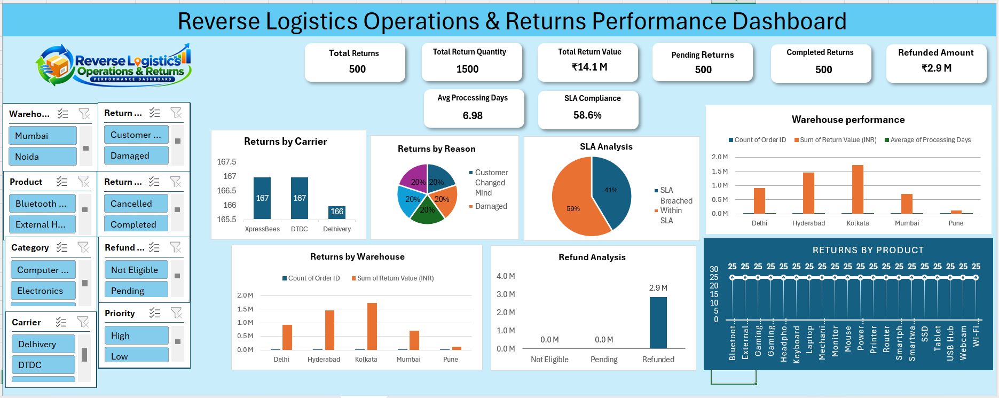

<h1 align="center">Reverse Logistics Operations & Returns Performance</h1>

  <b>Supply Chain Operations Analysis Project using Microsoft Excel</b>

  Returns Analysis • SLA Monitoring • Refund Tracking • Processing Time • Warehouse Performance

  

<h2>📌 Table of Contents</h2>
<ul>
  <li><a href="#overview">Overview</a></li>
  <li><a href="#objectives">Project Objectives</a></li>
  <li><a href="#tools">Tools & Technologies</a></li>
  <li><a href="#skills">Skills Demonstrated</a></li>
  <li><a href="#structure">Project Structure</a></li>
  <li><a href="#kpi">Key Performance Indicators</a></li>
  <li><a href="#analysis">Analysis Areas</a></li>
  <li><a href="#insights">Key Insights & Recommendations</a></li>
  <li><a href="#deliverables">Project Deliverables</a></li>
  <li><a href="#future">Future Improvements</a></li>
  <li><a href="#author">Author</a></li>
</ul>

<h2 id="overview">📊 Overview</h2>

The <b>Reverse Logistics Operations & Returns Performance</b> project analyzes customer return transactions and reverse-logistics operations using Microsoft Excel. The accompanying PowerPoint presents the project scope, operational workflow, KPIs, findings, and recommendations.

The project focuses on return volume and value, processing time, refund status, Service Level Agreement (SLA) compliance, return reasons, warehouse and carrier performance, and operational exceptions.

<h2 id="objectives">🎯 Project Objectives</h2>
<ul>
  <li>Analyze customer return transactions and return quantities.</li>
  <li>Monitor return value and refunded amount.</li>
  <li>Measure processing time and SLA compliance.</li>
  <li>Identify transactions processed within SLA and those that breached SLA.</li>
  <li>Review return patterns by warehouse, region, carrier, sales channel, and product.</li>
  <li>Analyze return reasons, inspection results, and disposition.</li>
  <li>Review pending and completed return counts.</li>
  <li>Identify operational exceptions and processing delays.</li>
  <li>Recommend practical improvements to return-processing operations.</li>
</ul>

<h2 id="tools">🛠️ Tools & Technologies</h2>
<table border="1" cellpadding="8">
  <tr><th>Tool</th><th>Purpose</th></tr>
  <tr><td>Microsoft Excel</td><td>Operational data review, analysis, and KPI reporting.</td></tr>
  <tr><td>Microsoft PowerPoint</td><td>Presentation of project scope, findings, and recommendations.</td></tr>
  <tr><td>GitHub</td><td>Project documentation and portfolio hosting.</td></tr>
</table>

<h2 id="skills">💡 Skills Demonstrated</h2>
<ul>
  <li>Excel-based Data Analysis</li>
  <li>KPI Monitoring and Reporting</li>
  <li>SLA Performance Analysis</li>
  <li>Returns and Refund Tracking</li>
  <li>Processing-Time Analysis</li>
  <li>Operational Exception Identification</li>
  <li>Business Insights and Recommendations</li>
  <li>Supply Chain Operations and Reverse Logistics</li>
  <li>Business Presentation</li>
</ul>

<h2 id="structure">📁 Project Structure</h2>
<pre>
Reverse_Logistics_Operations_Project/
│
├── Reverse Logistics Operations & Returns Performance Dashboard Excel file/
│   └── Reverse_Logistics_Operations_Excel_Project.xlsx
│
├── Reverse Logistics Operations & Returns Performance Dashboard Presentation/
│   └── Project_Presentation.pptx
│
├── Reverse_Logistics_Dashboard.png
└── README.md
</pre>

Keep the uploaded folder and file names consistent with this structure. If you upload the Excel workbook, dashboard image, and presentation directly into the repository root instead, update the paths above accordingly.

<h2 id="kpi">📌 Key Performance Indicators</h2>
<table border="1" cellpadding="8">
  <tr><th>KPI</th><th>Value reported in presentation</th></tr>
  <tr><td>Total Return Transactions</td><td><b>500</b></td></tr>
  <tr><td>Total Return Quantity</td><td><b>1,500</b></td></tr>
  <tr><td>Total Return Value</td><td><b>₹14.1 million</b></td></tr>
  <tr><td>Pending Returns</td><td><b>125</b></td></tr>
  <tr><td>Completed Returns</td><td><b>125</b></td></tr>
  <tr><td>Refunded Amount</td><td><b>₹2.9 million</b></td></tr>
  <tr><td>Average Processing Time</td><td><b>6.98 days</b></td></tr>
  <tr><td>Transactions Within SLA</td><td><b>293</b></td></tr>
  <tr><td>SLA-Breached Transactions</td><td><b>207</b></td></tr>
  <tr><td>SLA Compliance</td><td><b>58.6%</b></td></tr>
</table>

<i>Note: KPI values are reproduced from the project presentation. Verify them against the Excel workbook before using them in formal reporting. The pending and completed counts shown in the presentation may not account for all 500 transactions, so validate their definitions and calculations.</i>

<h2 id="analysis">🔎 Analysis Areas</h2>

<h3>1. Returns Performance</h3>
<ul>
  <li>Total return transactions and quantities</li>
  <li>Total return value</li>
  <li>Pending and completed returns</li>
  <li>Return patterns by product and return reason</li>
</ul>

<h3>2. SLA Performance</h3>
<ul>
  <li>Transactions processed within SLA</li>
  <li>SLA-breached transactions</li>
  <li>SLA compliance percentage</li>
  <li>Processing delays and exception prioritization</li>
</ul>

<h3>3. Processing Operations</h3>
<ul>
  <li>Average processing time</li>
  <li>Return workflow: receipt, inspection, disposition, refund or inventory update</li>
  <li>Warehouse and carrier performance</li>
  <li>Monitoring aging returns and workload</li>
</ul>

<h3>4. Refund Analysis</h3>
<ul>
  <li>Refunded amount and refund status</li>
  <li>Refund accuracy and timely completion</li>
  <li>Validation before operational closure</li>
</ul>

<h3>5. Return Reasons & Exceptions</h3>
<ul>
  <li>Return reasons, including customer changed mind</li>
  <li>Inspection and disposition tracking</li>
  <li>Recurring product, packaging, or process issues</li>
  <li>Warehouse and carrier performance review</li>
</ul>

<h2 id="insights">📈 Key Insights & Recommendations</h2>
<ul>
  <li>The reported average processing time is nearly seven days.</li>
  <li>Reported SLA compliance is 58.6%, with 207 transactions shown as SLA-breached.</li>
  <li>Prioritize SLA-breached returns using an exception queue.</li>
  <li>Monitor aging returns daily and escalate items approaching SLA limits.</li>
  <li>Review warehouse workload and rebalance where practical.</li>
  <li>Use return-reason trends to investigate product, packaging, or process issues.</li>
  <li>Validate refund status before closing return transactions.</li>
</ul>

<h2 id="deliverables">📄 Project Deliverables</h2>
<table border="1" cellpadding="8">
  <tr><th>File</th><th>Description</th></tr>
  <tr><td><code>Reverse_Logistics_Operations_Excel_Project.xlsx</code></td><td>Excel workbook for reverse-logistics operations analysis.</td></tr>
  <tr><td><code>Project_Presentation.pptx</code></td><td>Presentation covering KPIs, analysis, insights, and recommendations.</td></tr>
  <tr><td><code>Reverse_Logistics_Dashboard.png</code></td><td>Dashboard screenshot displayed at the top of this README.</td></tr>
  <tr><td><code>README.md</code></td><td>Project overview and GitHub documentation.</td></tr>
</table>

<h2 id="future">🚀 Future Improvements</h2>
<ul>
  <li>Create an interactive Excel dashboard with KPI cards, charts, and slicers.</li>
  <li>Add a daily aging report for pending returns.</li>
  <li>Track SLA compliance by warehouse, carrier, product, and return reason.</li>
  <li>Investigate causes of SLA breaches and long processing times.</li>
  <li>Reconcile pending and completed counts against the full dataset.</li>
  <li>Validate KPI calculations and definitions against source data.</li>
  <li>Add refund turnaround-time and refund-accuracy metrics.</li>
  <li>Introduce regular operational reporting and performance targets.</li>
</ul>

<h2 id="author">👨‍💻 Author</h2>

  <b>Sourav Patra</b> 
  Data Analyst | Excel | SQL | Power BI | Supply Chain Operations

This project demonstrates practical skills in operational data analysis, KPI reporting, SLA monitoring, refund tracking, reverse logistics, and business communication.

  <b>⭐ Reverse Logistics Operations & Returns Performance</b> 
  Turning returns data into clear and actionable operational insights.

